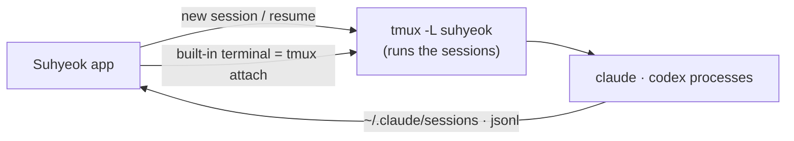
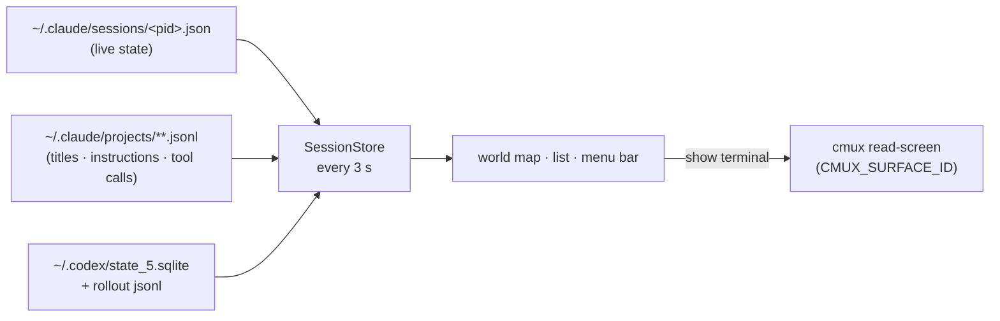

<p align="center"></p>

<p align="center"><a href="README.md">한국어</a> · <b>English</b></p>

# Suhyeok — a Mac app to command all your local agent sessions from one screen

> However many agents work on their own,
> one radiant general commands them at a glance.

- Name = 帥赫 (suhyeok: "general" + "radiant"), "the radiant general". In Korean the two syllables open the two lines above
- Gathers the Claude Code and Codex sessions scattered across terminal windows into one pixel-RPG guild hall


Landing page: https://oyhoyhk.github.io/suhyeok/?lang=en

## Install

```bash
brew install oyhoyhk/tap/suhyeok   # installs tmux too
suhyeok                            # launch the app
```

- Updates: when a new version is out, an "Install update" button appears at the bottom of the sidebar (checked at launch and every 6 hours). It runs `brew upgrade` and relaunches the app; agent sessions keep running
- Users on 0.1.1 or earlier: that version has no update button, so run `brew upgrade suhyeok` once yourself
- Requirements: Apple Silicon Mac, macOS 14 or later, Claude Code or Codex CLI
- Add to Launchpad and Spotlight: `ln -sf "$(brew --prefix)/opt/suhyeok/수혁.app" ~/Applications/수혁.app`

### Windows and Linux (desktop app)

Suhyeok for Windows and Linux runs the Suhyeok server on this computer and also connects to Suhyeok on other computers (Macs included). Closing the window keeps it in the tray, and the server, which holds the sessions, keeps running after you quit the app (tray → Stop server turns it off).

- Install: `Suhyeok_<version>_x64-setup.exe` (Windows; unsigned → in SmartScreen choose "More info → Run anyway"), `Suhyeok_<version>_amd64.AppImage` or `.deb` (Linux) from [Releases](https://github.com/oyhoyhk/suhyeok/releases)
- Connect to another computer: get a pairing link from Suhyeok there (Mac: Settings → Mobile access → Start pairing → "PC용 링크 복사" (Copy link for PC; not yet translated in the app); Windows/Linux: Suhyeok menu → Connect another device…) → within 60 seconds paste it into Server menu → Add another server… → allow on that computer
- To connect to a Mac: Suhyeok 0.2.5 or later on the Mac with Mobile access on. In a browser, open `<Mac address>/desk`
- Source: `desktop/` (Tauri 2; the server is `server-rs/`), build: `.github/workflows/desktop.yml` (attaches the installers when a release is published)

## Workspace — create and run sessions inside Suhyeok

- ＋ New session (⌘N) → agent (Claude Code or Codex) · working folder · first instruction → runs on Suhyeok's own tmux server
- Sidebar = World · List · Suhyeok sessions · Other terminals · Recent chats
- Suhyeok sessions = operated directly in the built-in terminal (SwiftTerm). Keystrokes, permission menus and shortcuts all work as usual
- Sessions survive quitting or restarting Suhyeok (the tmux server runs them). In a pinch, from another terminal: `tmux -L suhyeok attach -t <name>`
- How a session opens (Settings ⌘,): **chat view (default)** or terminal
  - Chat view = a large RPG-NPC-style dialogue window showing the illustration, the agent's answers and your instructions in turn. What you type goes to that session's terminal
  - Permission and choice menus = answer with quick keys (↑ ↓ ⏎ Esc 1 2 3) + "Show screen"
  - Click a character in the world → "Chat" → a dialogue window over the map
- Migration (sidebar "Other terminals" → "Move to Suhyeok…"): pick cmux, Orca or tmux sessions and move them into Suhyeok
  - Sends `/exit` to the original session → confirms it ended → Suhyeok takes over the full conversation with `--resume`
  - Sessions that are working are skipped so nothing gets cut off. If the original terminal can't receive input, Suhyeok only resumes the conversation and tells you
- How instructions are delivered: tmux (`paste-buffer`, keeps multiple lines) · cmux (`send`, joined into one line, needs the socket in password mode) · Orca (`terminal send`)
- Recent chats (7 days) → one "Resume" brings it back as a Suhyeok session
- Changes (button in the session header): shows the diff since the working folder's last commit alongside, refreshed every 4 seconds
  - Click a line → comment → "Send to agent" sends all comments as one instruction
  - Commits only the checked files. Other changes and the staging state stay as they are. If a hook rejects the commit, its output is shown
  - When the session view is narrow, it opens below instead of beside. Drag the divider to resize
- Restore after reboot: open Suhyeok agent sessions (conversation IDs) are recorded in `~/Library/Application Support/Suhyeok/open-sessions.json`
  - At launch, if tmux has no agents, the sidebar offers "Reopen all" → `--resume` brings back the same conversation with the same character
  - Claude sessions without a first message have no conversation file yet, so they are not recorded
- No tmux prefix key (Claude Code keeps ctrl+b), status line hidden — config file `~/Library/Application Support/Suhyeok/tmux.conf`



## Features at a glance

- 1 session = 1 character. It walks to a different area of the guild hall depending on its state
- A working character acts out the tool it is using (edit = typing, Bash = hammering, read = nodding)
- Hover → name · session title · project · last instruction
- Click → a small status card → "Show terminal" shows that cmux terminal's screen live
- Mac menu bar → flag icon + number of working agents, and a list of working agents

## States and areas

| State | Condition | Area | Animation |
|---|---|---|---|
| Working | generating a response or running a shell command | workbench hall (left) | tool-specific action + icon overhead |
| Waiting | less than 10 minutes since the response ended | tavern (center) | "…" speech bubble |
| Resting | 10 minutes or more since the response ended | lounge (right) | zzz |

- Change when an agent starts resting: `defaults write com.pickuma.agentdeck restAfterMinutes 30`

## Data flow



- Session data is read only from local files and never sent out. The network is used only for update checks, Mobile access (Cloudflare tunnel) and crystal server settlement when you turn them on, `/feedback` reports, and the first download of the voice model
- Codex has no session registry, so Codex sessions are estimated as "updated in the last 30 minutes" (marked "estimated" on the card)

## Run from source

```bash
./build.sh            # builds 수혁.app (no Xcode project needed, Swift 5.9+ / macOS 14+)
open 수혁.app
```

- Check without a window: `수혁.app/Contents/MacOS/AgentDeck --snapshot out.png`
- Publish a new version (maintainer): `./publish.sh 0.1.2 "summary of changes"` → build · GitHub release · tap Formula update in one go
- Check for updates: `수혁.app/Contents/MacOS/AgentDeck --check-update`
- Command-line chat: `--send <sessionID> "instruction"` · `--press <sessionID> escape` · `--migrate <sessionID>` · `--snapshot-dialogue <sessionID> out.png`
- Command-line session management: `--new-session <Claude|Codex> <folder> [instruction]` · `--list-sessions` · `--kill-session <name>` · `--snapshot-hosted <name> out.png`
- Command-line new conversation: `--clear <sessionID> [out.png]` → sends /clear and prints how long the new conversation ID took (out.png = the waiting spinner screen)
- Command-line changes: `--snapshot-changes <folder> out.png`
- Command-line restore: `--open-sessions [out.png]` → the sessions that would be recorded (out.png = the sidebar suggestion card) · `--reopen <conversationID>` → reopen one recorded session
- Run commands that read the session list with a release build (`swift build -c release`). A debug build takes over 30 seconds to read large conversation logs and returns an empty result
- Recapture the agent-screen regression fixtures: `./capture-screens.sh <output folder>` → screens per state + `--parse-menu` output. Put changed screens in `Tests/AgentDeckTests/Fixtures/screens` and run `swift test`

### Environment variables

The test variables only affect the command-line checks above. They are not used in normal runs.

| Variable | Used by | Effect |
|---|---|---|
| `SUHYEOK_TEST_PASTEBOARD=<name>` | `--snapshot-dialogue` | ⌘V twice (long text, image) from a separate pasteboard with that name. Your clipboard is not touched |
| `SUHYEOK_TEST_DROP=<file>` | `--snapshot-dialogue` | drops a file in the middle of the chat view |
| `SUHYEOK_TEST_DROP_AT=field` | `--snapshot-dialogue` | drops onto the input field instead |
| `SUHYEOK_SNAPSHOT_SCROLL=top` | `--snapshot-dialogue` | the chat scrolled to the top (to check the "Jump to bottom" button) |
| `SUHYEOK_TEST_NOTE=<text>` | `--snapshot-changes` | the screen with a comment field open on one line |
| `SUHYEOK_TEST_NOTE_LINE=<text>` | `--snapshot-changes` | the line to comment on (first line containing that text, default `let limit`) |
| `SUHYEOK_TEST_NOTE_SAVE=1` | `--snapshot-changes` | the screen after the comment is added |
| `SUHYEOK_TEST_TYPE=<text>` | `--snapshot-hosted` | types into the terminal as if committed by an input method (for checking Hangul) |
| `SUHYEOK_RESTORE_FILE=<file>` | `--open-sessions` · `--reopen` | changes the restore record file. The running app rewrites the default file every 3 seconds, so tests use this variable to stay separate |
| `SUHYEOK_MOBILE_PORT=<port>` | `--serve-mobile` | runs the test phone server on a different port from the app |
| `SUHYEOK_NO_KEYCHAIN=1` | app launch | runs without reading the ledger key (when you can't answer the keychain prompt). Crystal earning pauses until the next normal launch |
| `SUHYEOK_DICTATION_LOG=<file>` | app launch | also writes the dictation log to a file |
| `SUHYEOK_DEBUG=1` | app launch | debug output for world departure animations and mermaid heights |
| `SUHYEOK_FAKE_DEPART=1` | app launch | plays the first agent's departure animation once |
| `SUHYEOK_SESSION` | (set by Suhyeok) | the Suhyeok tmux session name. Agent processes inherit it, and Suhyeok uses it to link Codex sessions to panes. Do not set it yourself |

## Show terminal — works with any terminal

- Status card "Show terminal" → switch between [Terminal | Conversation log]
- Reading the terminal screen: the host is identified from the agent process's environment variables

| Host | Identified by | Read command |
|---|---|---|
| tmux | `TMUX`, `TMUX_PANE` | `tmux -S <socket> capture-pane` |
| Orca | `ORCA_TERMINAL_HANDLE` | `orca terminal read --terminal` |
| cmux | `CMUX_WORKSPACE_ID`, `CMUX_SURFACE_ID` | `cmux read-screen` |

- Order checked: tmux → Orca → cmux (tmux inside cmux is read more accurately through tmux)
- Terminals with no screen-reading API (Ghostty alone, xterm, Alacritty, Warp, the VS Code and Zed built-ins) switch to the conversation log automatically
- Conversation log = instructions, responses, tool calls and results (6-line summaries) from the Claude jsonl and Codex rollout. Always works, whatever the terminal
- cmux prerequisite: set `automation.socketControlMode` to `password` and restart cmux once. Check with `cmux capabilities | grep access_mode`
- Check without a window: `수혁.app/Contents/MacOS/AgentDeck --terminal <sessionID> [transcript]`

## Art

- 32 characters (sprites + illustrations), the map and icons = generated with Higgsfield (seedream_5_0_flash, the map with z_image)
- Roster `art/roster.json` → generation `art/gen.py` → background removal and downscaling `art/process.py` → icons and favicons `art/brand.py`
