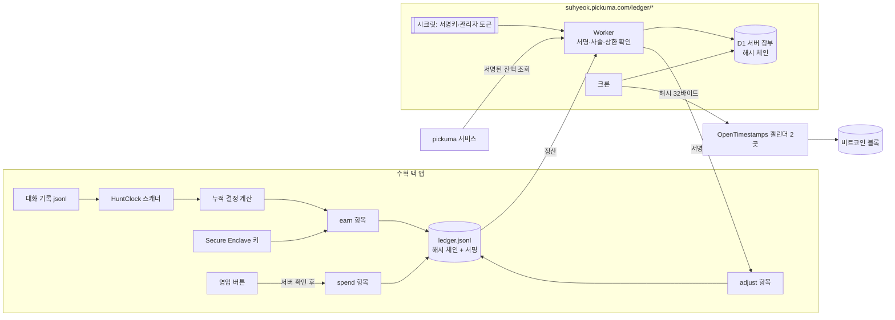
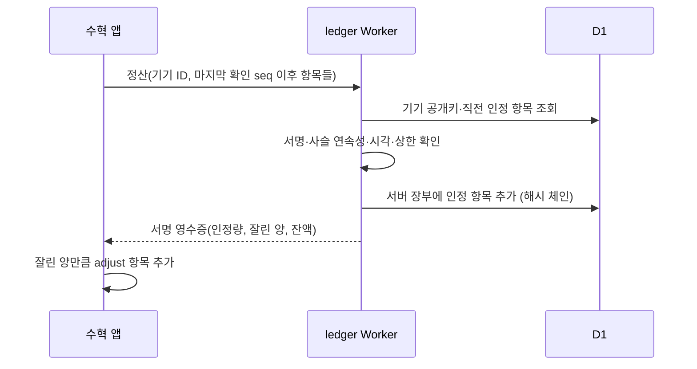
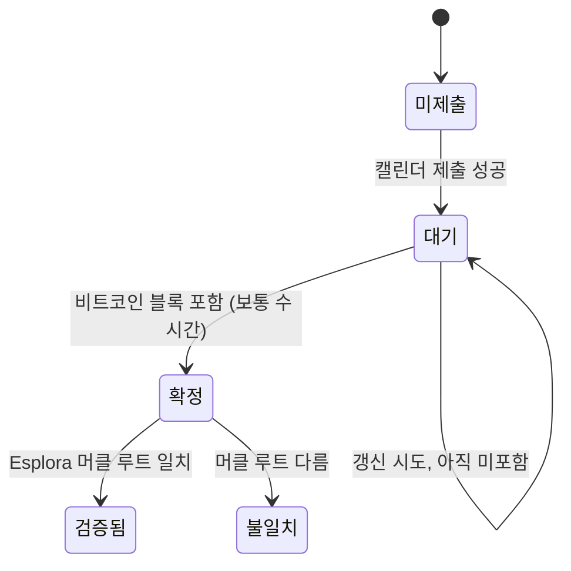

# feat: 결정 영구 지갑, 보안칩 서명 장부, pickuma 발행 서버, 비트코인 공증

---

## Goal Capsule

- **목표:** 결정을 세션 수명과 무관하게 쌓이는 재화로 전환함. pickuma 생태계에서는 중앙 서버가 서명한 잔액만 인정함
- **권한 순서:** 사용자 지시 > 이 문서의 Product Contract > Planning Contract > 구현 중 판단
- **정지 조건**
  - 장부 형식이 한 번 기록된 뒤 바뀌어야 하는 상황이면 멈추고 보고함 (해시 사슬 호환성이 깨짐)
  - 비밀키·관리자 토큰이 저장소나 앱 번들에 들어갈 상황이면 멈춤
  - OpenTimestamps 증명 파싱이 공식 테스트 벡터와 맞지 않으면 공증 검증을 넣지 말고 보고함
  - 운영 배포(Worker 배포, D1 생성, DNS·라우트 변경)는 사용자 승인 후에만 실행함
- **실행 프로필**
  - 맥 앱: Swift 단일 실행 타깃(SwiftPM), 테스트 타깃 신설. 외부 의존성 추가 없음(CryptoKit·Security·URLSession)
  - 서버: Cloudflare Worker + D1, 빌드 없는 JS (pickuma-gomoku와 같은 구성)
- **가상화폐 미사용:** 코인·지갑·수수료 없음. 비트코인 블록체인은 공증 기록 용도로만 씀

---

## Product Contract

### Summary

- 로컬: 결정을 해시 체인 장부(`ledger.jsonl`)에 추가만 하는 방식으로 기록함. 항목마다 맥 보안칩(Secure Enclave) 키로 서명함
- 서버: `suhyeok.pickuma.com/ledger/*`의 발행 서버가 기기별 잔액의 기준이 됨. 비밀키는 Worker 시크릿에만 있음
  - 앱은 서명된 장부 항목을 서버에 정산함. 서버는 서명·사슬·물리적 상한을 확인한 뒤 자기 장부에 기록하고 서명한 영수증을 돌려줌
  - pickuma 생태계 서비스는 서버가 서명한 잔액만 믿음
- 공증: 서버 장부 최신 해시를 하루 1회 OpenTimestamps로 비트코인 블록에 기록함. 운영자(Owen)도 과거 잔액을 몰래 고치지 못한다는 증명
- 수입 공식: 활동시간 기본 + 턴 완료 보너스 + 커밋 보너스. 토큰은 '마나 소모'로 표시만 함
- 기존 대화 기록에서 계산되는 결정은 한 번 이관함 (서버 반영은 관리자 승인)
- 첫 소비처: 용병 영입 (캐릭터 32명 중 8명만 열고 나머지를 결정으로 영입)

### Problem Frame

- 현재 결정은 `HuntClock`이 메모리에서 계산함. 세션이 닫히면 총액에서 빠짐 (`Sources/AgentDeck/App.swift`의 `totalCrystals`)
- pid 두 개가 같은 대화를 열면 같은 대화 기록 파일을 두 번 셈
- 결정을 쓸 곳이 없어 쌓이는 동기가 없음
- 사용자 요구
  - 재화를 함부로 수정할 수 없어야 함
  - 앱이 오픈소스여도 pickuma 생태계에는 조작된 재화가 들어오지 못해야 함

### 보장 범위 (위협 모델)

| 공격 | 로컬 장부 | pickuma 생태계 | 이유 |
|---|---|---|---|
| 장부 중간 항목 수정·삭제·순서 변경 | ✅ 탐지 | ✅ 거부 | 해시 사슬이 깨짐 |
| 해시를 전부 다시 계산해 장부 바꿔치기 | ✅ 탐지 | ✅ 거부 | 보안칩 서명을 다시 만들 수 없음 |
| 장부·키를 지우고 새로 시작 | ❌ | ✅ 서버 잔액 유지 | 서버가 기기별 잔액을 보관함. 새 키는 새 기기 등록 필요 |
| 소스를 고친 앱이 가짜 활동을 보고 | ❌ | △ 상한까지만 | 서버가 시간당 물리적 상한을 넘는 지급을 잘라냄 |
| 대화 기록 파일 위조 | ❌ | △ 상한까지만 | 입력이 로컬 파일. 상한으로 피해를 묶음 |
| 운영자가 서버 DB에서 잔액 수정 | — | ✅ 탐지 | 서버 장부 해시 사슬 + 비트코인 공증과 불일치 |
| 서버 비밀키 유출 | — | ❌ | 키 교체 절차로 대응 (후속 작업) |

- 이 표를 설정 화면의 장부 설명에 그대로 노출함

### Requirements

**로컬 장부·지갑**
- **R1.** 결정 지급·소비는 모두 `~/Library/Application Support/Suhyeok/ledger.jsonl`에 추가만 하는 방식으로 기록함
- **R2.** 장부 항목마다 직전 항목 해시를 포함한 SHA-256 해시를 가짐. 첫 항목의 직전 해시는 0으로 채움
- **R3.** 잔액 = 장부 금액 합계. 앱 메모리 값을 잔액으로 쓰지 않음
- **R4.** 같은 대화 기록 파일은 pid 개수와 관계없이 한 번만 지급함
- **R5.** 앱 실행 중이 아니던 시간의 활동도 다음 실행 때 지급함 (최근 7일 대화 기록 대상)
- **R6.** 수입 = 활동시간(현재 등급 공식) + 턴 완료 보너스 + `git commit` 성공 보너스
- **R7.** 토큰 사용량은 지급에 쓰지 않음. 세션 카드에 '마나 소모'로 표시함
- **R8.** 장부를 처음 만들 때 과거 대화 기록 전체를 새 공식으로 계산해 이관 항목(genesis)으로 기록함
- **R9.** 앱 시작 시 장부 전체를 검증함. 사슬이나 서명이 깨지면 지급·소비를 멈추고 '장부 훼손' 배너를 띄움
- **R10.** 장부 항목마다 Secure Enclave P-256 키로 항목 해시에 서명함. 공개키는 첫 항목에 기록함
- **R11.** 보안칩이 없는 맥은 키체인 소프트웨어 키로 대신하고 '약한 보호'로 표시함

**영입**
- **R12.** 시작 시 캐릭터 8명만 열림. 나머지는 결정으로 영입함. 영입은 장부의 소비 항목으로 기록함
- **R13.** 서버 연결을 켠 기기에서 영입은 서버 확인 후에만 확정함. 오프라인이면 영입 버튼을 비활성화함
- **R14.** 잔액보다 비싼 영입은 거부함. 잔액이 음수가 되는 항목은 기록하지 않음

**pickuma 발행 서버**
- **R15.** 서버는 `suhyeok.pickuma.com/ledger/*` 경로에서 동작함. 나머지 경로는 기존 폰 터널이 그대로 처리함
- **R16.** 기기 등록: 관리자가 발급한 일회용 등록 코드 + 기기의 보안칩 공개키. 등록 코드 없이는 등록 불가
- **R17.** 정산: 앱은 마지막 확인 이후의 로컬 장부 항목을 보냄. 서버는 서명, 사슬 연속성, 시각 정상 여부를 확인함
- **R18.** 물리적 상한: 기기별로 '이전 정산 시각부터 경과한 실제 시간'에 비례한 상한을 넘는 지급은 잘라냄. 잘린 양은 영수증에 표시함
- **R19.** 앱은 영수증의 잘린 양만큼 로컬 장부에 조정 항목(`adjust`)을 추가함. 정산 후 로컬 잔액 = 서버 잔액
- **R20.** genesis 항목은 서버에서 '승인 대기'로 두고 관리자가 승인한 뒤 잔액에 반영함
- **R21.** 서버도 자기 장부를 해시 체인으로 추가만 하는 방식으로 기록함. 관리자의 정정도 정정 항목으로 추가함. 행 수정·삭제 없음
- **R22.** 서버 영수증과 잔액 조회 응답은 서버 Ed25519 키로 서명함. 공개키는 `/ledger/v1/pubkey`에 공개함
- **R23.** 비밀키·관리자 토큰은 Worker 시크릿에만 둠. 저장소와 앱에 넣지 않음
- **R24.** 서버 연결은 설정에서 켜고 끔. 끄면 로컬 장부만 동작함

**비트코인 공증 (서버)**
- **R25.** Worker 크론이 하루 1회 서버 장부 최신 해시를 OpenTimestamps 캘린더 2곳 이상에 제출함
- **R26.** 미확정 증명은 6시간마다 비트코인 확정 증명으로 갱신함
- **R27.** 증명 목록과 `.ots` 파일을 `/ledger/v1/anchors`로 공개함. 외부로 보내는 값은 해시 32바이트뿐임
- **R28.** 앱은 공증을 검증함: 증명 연산 재생 → 머클 루트 → 공개 Esplora API의 블록 헤더와 대조. 결과를 '비트코인 #블록높이 확정'으로 표시함

### Acceptance Examples

- **AE1.** pid 91263·93157이 같은 대화를 열고 10분 일함 → 지급 항목은 그 대화 기록 파일 기준 1건
- **AE2.** 장부 3번째 항목 금액을 텍스트 편집기로 고침 → 다음 실행 시 '장부 훼손 (항목 #3)' 배너, 지급 중단
- **AE3.** 해시를 전부 다시 계산해 장부를 덮어씀 → 서명 검증 실패 배너. 서버 정산도 거부됨
- **AE4.** 앱을 끈 채 3시간 작업 후 앱 실행 → 그 3시간분 결정이 지급됨
- **AE5.** 대화 기록 파일이 줄어듦(재작성) → 음수 지급 없음, 기존 지급액 유지
- **AE6.** 고친 앱이 1시간 동안 결정 500을 보고함 → 서버는 상한까지만 인정, 영수증에 잘린 양 표시, 앱이 조정 항목 추가
- **AE7.** 로컬 장부·키를 지우고 재실행 → 로컬은 0부터 시작. 서버에는 기존 기기 잔액이 남음. 새 키로 정산하려면 새 등록 코드가 필요함
- **AE8.** 서버 D1에서 잔액 행을 직접 고침 → 서버 장부 검증과 공증 대조에서 불일치

### Scope Boundaries

- 제외: 업비트 실제 매수, 테스트넷 토큰, 사용자 간 거래·순위
- 제외: 폰 앱의 영입 화면. 폰에는 잔액만 표시함 (`MobilePage.swift`의 💎 표시를 장부 잔액으로 교체)
- 제외: 다른 pickuma 서비스에서 결정을 쓰는 기능. 이번에는 서명된 잔액 조회 API까지만 제공함

### Deferred to Follow-Up Work

- pickuma 서비스용 소비 API (서비스별 키, 서버 측 차감)
- 서버 비밀키 교체 절차, 기기 키 이전(이전 키가 새 키를 승인)
- 테스트 통과 보너스: 대화 기록에서 '테스트 통과' 판정 규칙이 불안정해 오지급 위험이 있음
- 길드홀 증축·장식 상점, 셀프 보상 상점

---

## Planning Contract

### Key Technical Decisions

- **KTD1. 지급 = 누적 계산값 − 기지급액 (대화 기록 파일 단위)**
  - 대화 기록 파일마다 '처음부터 계산한 누적 결정'을 구하고, 장부에 이미 지급된 합계와의 차이만 지급함
  - 이유: 오프셋 커서를 따로 저장하지 않아도 같은 결과가 나옴(멱등). pid 중복(R4)과 앱 꺼짐 기간(R5)이 같은 방식으로 해결됨
  - 차이가 0 이하이면 기록하지 않음 (AE5)
- **KTD2. 장부 = JSONL + 정규화 직렬화 해시**
  - 해시 입력은 키 순서를 고정한 정규화 JSON(`hash`·`sig` 필드 제외). `JSONEncoder.outputFormatting = .sortedKeys` 사용
  - 항목 필드: `seq`, `time`, `kind`(genesis/earn/spend/adjust), `source`(대화 기록 경로 또는 상품 ID), `amount`, `rule`(공식 버전), `note`, `prev`, `hash`, `sig`
  - 서버도 같은 정규화 규칙으로 해시를 다시 계산함 → Swift와 JS가 같은 바이트를 만들어야 함. 공통 테스트 벡터 파일로 고정함
  - 이유: 사람이 읽을 수 있음. 한 줄씩 추가만 해서 쓰기 도중 앱이 꺼져도 앞부분이 보존됨
- **KTD3. 기기 서명 키는 Secure Enclave에서 생성함**
  - CryptoKit Secure Enclave P-256 서명 키. 개인키는 칩 밖으로 나오지 않음. 키체인에는 이 맥의 보안칩에서만 쓸 수 있는 암호화된 키 참조만 저장함
  - 같은 공개키를 서버 기기 등록에 씀. 서버는 WebCrypto ECDSA P-256으로 검증함
  - 트레이드오프: 맥 교체·키체인 초기화 시 새 항목 서명 불가 → 로컬은 읽기 전용, 서버 잔액은 유지됨(AE7)
- **KTD4. 서버가 잔액의 기준임 (오프라인 우선 + 서버 정산)**
  - 앱은 오프라인에서도 로컬 장부에 지급을 쌓음. 연결되면 정산함
  - 서버는 잘라낸 양을 영수증으로 알리고, 앱이 `adjust` 항목으로 맞춤. 로컬 장부는 계속 추가만 함
  - 소비(영입)는 서버 확인을 먼저 받음 → 서버에서 잔액 부족으로 되돌리는 경우가 생기지 않음
- **KTD5. 물리적 상한은 실제 경과 시간 기준**
  - 상한 = (이번 정산 항목 시각 − 직전 인정 항목 시각) × 시간당 최대치 × 동시 에이전트 상한 + 보너스 상한
  - 초안: 시간당 18(10분당 3) × 동시 4, 턴 보너스 시간당 30, 커밋 보너스 시간당 10. 실측 후 조정함
  - 미래 시각(서버 시각 + 5분 초과) 항목과 직전 항목보다 과거 시각인 항목은 거부함
- **KTD6. 서버는 suhyeok.pickuma.com의 `/ledger/*` 경로 Worker 라우트로 붙임**
  - 이 호스트는 이미 폰용 Cloudflare 고정 터널(`suhyeok`)의 CNAME임. 커스텀 도메인으로 붙이면 호스트 전체를 가져가 폰 연결이 끊김 → 경로 라우트만 씀
  - 함정: 현재 CF API 토큰은 Workers Routes 권한이 없음(pickuma-gomoku 배포에서 확인). `wrangler.toml`에 `routes`를 넣으면 업로드 후 배포가 실패함 → 라우트는 사용자가 대시보드에서 한 번 추가하거나, 토큰 권한을 올림
  - 폰 서버(`MobileServer.swift`)가 `/ledger` 경로를 쓰지 않는지 착수 시 확인함
- **KTD7. 서버 코드는 agent-deck 저장소 `server/ledger/`에 둠**
  - 공개 저장소지만 보안은 시크릿에 의존하므로 코드 공개는 문제없음. 앱과 서버의 정규화 해시 테스트 벡터를 한 저장소에서 공유함
  - 구성은 pickuma-gomoku와 같음: `worker.js` + `schema.sql` + `wrangler.toml`, 빌드 없음
- **KTD8. 서버 서명은 Ed25519 (WebCrypto)**
  - 비밀키는 Worker 시크릿 `LEDGER_SIGNING_KEY`, 관리자 토큰은 `LEDGER_ADMIN_TOKEN`
  - 영수증 = {기기, 서버 seq, 인정량, 잘린 양, 잔액, 서버 장부 최신 해시} + 서명
- **KTD9. 공증은 서버 크론이 하고, 검증은 앱이 함**
  - Worker 크론 트리거: 매일 제출, 6시간마다 갱신. 증명은 D1에 바이트로 저장함
  - 갱신에는 미확정 증명의 커밋먼트가 필요함 → 최소 OTS 파서(JS)를 둠. `javascript-opentimestamps`가 Workers에서 그대로 돌면 그것을 우선 씀
  - 검증은 앱의 Swift 파서 + Esplora(blockstream.info, 대체 mempool.space). 공개 탐색기를 믿는 약점이 있으나, `.ots` 파일을 공개해 누구나 `ots verify`로 독립 검증할 수 있음
- **KTD10. 장부가 깨지면 읽기 전용**
  - 자동 복구하지 않음. 배너에 첫 불일치 항목 번호를 표시함
  - 사용자가 '새 장부 시작'을 고르면 기존 파일은 `ledger.broken-<시각>.jsonl`로 보관함. 삭제하지 않음
- **KTD11. 턴 완료·커밋 판정은 대화 기록 스캐너(`HuntClock`)에 붙임**
  - 지금 스캐너는 `"timestamp"` 필드만 뽑음. 턴 끝 표시와 Bash `git commit` 성공 여부를 추가로 뽑음
  - 큰 줄을 전부 디코딩하지 않는 현재 방식(바이트 검색)을 유지함
- **KTD12. 영입 해제 상태는 장부의 소비 항목에서 복원함**
  - 별도 UserDefaults 키를 두지 않음. 장부가 유일한 기준임
  - `CharacterAssigner`는 열린 캐릭터 중에서만 배정함. 세션 수가 열린 수보다 많으면 기존처럼 중복 배정함

### High-Level Technical Design

### Assumptions

- Claude 대화 기록의 턴 끝은 assistant 메시지의 `stop_reason`(예: `end_turn`)으로 판정 가능함. Codex는 rollout의 `task_complete`로 판정함
- 보너스 값 초안: 턴 완료 1, 커밋 3. 활동시간 공식(10분당 1·2·3)은 유지함
- 영입 가격 초안: 50부터 시작해 한 명마다 증가함. 이관 예상 잔액을 본 뒤 조정함
- 등록은 관리자(Owen)가 코드를 발급하는 초대 방식임. 공개 가입은 열지 않음
- Cloudflare Workers의 WebCrypto가 ECDSA P-256 검증과 Ed25519 서명을 지원함 (착수 시 확인)

### Sequencing

- U1 → U2 → U3 → U4 순서가 필수임 (장부가 먼저 있어야 지급·이관이 붙음)
- U6(서버)은 U1 이후 앱 작업과 병렬로 진행할 수 있음. 정규화 해시 테스트 벡터를 U1에서 먼저 고정함
- U5(영입)는 U3 이후. 서버 확인 연결은 U6 이후 붙임
- U7(공증)은 U6 이후

---

## Implementation Units

### U1. 테스트 타깃 신설과 서명된 해시 체인 장부

**Goal:** 장부 읽기·추가·검증·잔액 계산과 보안칩 서명을 순수 로직으로 만듦
**Requirements:** R1, R2, R3, R9, R10, R11
**Dependencies:** 없음
**Files:**
- `Sources/AgentDeck/Ledger.swift` (신규)
- `Sources/AgentDeck/LedgerSigner.swift` (신규: 보안칩 키 생성·보관·서명, 소프트웨어 키 대체)
- `Package.swift` (테스트 타깃 추가)
- `Tests/AgentDeckTests/LedgerTests.swift` (신규)
- `server/ledger/test/vectors.json` (신규: Swift·JS 공통 정규화 해시 테스트 벡터)

**Approach:**
- 장부 파일 경로를 주입받는 구조로 만들어 테스트에서 임시 디렉터리를 씀
- 추가는 파일 끝에 한 줄 쓰기 + `fsync`. 직렬 큐 하나로만 씀
- 검증은 처음부터 끝까지 해시·서명 재계산. 결과는 '정상' 또는 '첫 불일치 seq'
- 마지막 줄이 줄바꿈 없이 잘려 있으면 쓰기 도중 종료로 보고 그 줄만 무시함 (훼손으로 보지 않음)
- 서명 기능은 프로토콜로 분리함. 테스트는 소프트웨어 키, 앱은 보안칩 키를 씀
- 키가 없거나 쓸 수 없으면 장부를 읽기 전용으로 둠 (검증은 첫 항목의 공개키로 계속 가능)

**Execution note:** 테스트 먼저 작성함. 해시 형식은 한 번 기록되면 바꿀 수 없음

**Test scenarios:**
- 빈 장부에 항목 3개 추가 → 검증 정상, 잔액 = 금액 합계, 첫 항목 `prev`는 0 64자리
- 2번째 항목 금액 수정 → 검증 결과 '첫 불일치 seq 2' (Covers AE2.)
- 항목 순서 바꿈 → 검증 실패
- 마지막 줄이 반쯤 잘린 파일 → 잘린 줄 무시, 검증 정상
- 같은 내용을 두 번 직렬화 → 해시 동일. 공통 벡터 파일의 기대 해시와 일치
- 한글·이모지가 든 `note` → 벡터 기대 해시와 일치 (JSON 이스케이프 차이 감지)
- 잔액 10에서 20 소비 시도 → 거부, 장부 변화 없음 (R14)
- 금액을 고친 뒤 해시를 전부 다시 계산(키 없음) → 서명 검증 실패 (Covers AE3.)
- 다른 키로 서명한 항목 끼워 넣기 → 첫 항목 공개키와 불일치로 실패
- 키 접근 불가 상태 → 추가 거부, 검증은 성공

**Verification:** 테스트 통과. 실제 앱에서 보안칩 키로 서명된 항목이 `--ledger` 출력에 '서명 정상'으로 나옴

### U2. 수입 공식 확장 (턴 완료·커밋)

**Goal:** 대화 기록 파일 하나의 누적 결정을 새 공식으로 계산함
**Requirements:** R6, R7
**Dependencies:** U1 (테스트 타깃)
**Files:**
- `Sources/AgentDeck/Hunt.swift`
- `Tests/AgentDeckTests/HuntTests.swift` (신규)
- `Tests/AgentDeckTests/Fixtures/` (작은 Claude·Codex 대화 기록 샘플)

**Approach:**
- `Hunt.Progress`에 턴 완료 수·커밋 수·누적 결정(공식 버전 포함)을 추가함
- 바이트 검색으로 턴 끝 표시와 Bash 도구 호출의 `git commit`을 찾음. 커밋 성공은 짝이 되는 도구 결과가 오류가 아닐 때만 셈
- 토큰은 `usage` 필드의 출력 토큰을 합쳐 '마나'로 따로 보관함. 결정 계산에 쓰지 않음
- 공식 버전 상수 `rule = 1`을 둠

**Test scenarios:**
- 활동 20분, 턴 2개, 커밋 1개 샘플 → 결정 = 2 + 2 + 3
- 실패한 `git commit`(오류 결과) → 커밋 보너스 없음
- 사용자 메시지 본문에만 `git commit` 문자열이 있음 → 보너스 없음
- Codex rollout의 `task_complete` 2개 → 턴 보너스 2
- 증분 스캔과 전체 재스캔 결과가 같음

**Verification:** 테스트 통과. `--hunt` 디버그 출력에 턴·커밋·마나가 함께 나옴

### U3. 지급 엔진과 영구 지갑 연결

**Goal:** 누적 계산값과 기지급액의 차이를 장부에 지급하고, 화면 잔액을 장부 기준으로 바꿈
**Requirements:** R3, R4, R5, R7
**Dependencies:** U1, U2
**Files:**
- `Sources/AgentDeck/Wallet.swift` (신규)
- `Sources/AgentDeck/App.swift` (`totalCrystals`, `huntLine`, refresh 경로)
- `Sources/AgentDeck/WorldView.swift` (결정 표시)
- `Sources/AgentDeck/MobilePage.swift`, `Sources/AgentDeck/MobileServer.swift` (폰 잔액)
- `Tests/AgentDeckTests/WalletTests.swift` (신규)

**Approach:**
- 지급 대상 = 라이브 세션의 대화 기록 + 최근 7일 대화 기록 목록(사이드바용으로 이미 읽는 목록), 경로 기준 중복 제거
- 정산 주기 1분. 3초 refresh마다 쓰지 않음
- 장부에서 파일별 기지급 합계 맵을 시작 시 한 번 만들고 지급할 때 갱신함
- 세션 카드 문구에 '마나 소모'를 추가함

**Test scenarios:**
- 같은 경로를 가진 세션 2개 → 지급 1건 (Covers AE1.)
- 계산값 12, 기지급 10 → 지급 2. 다시 정산 → 지급 없음
- 계산값이 기지급보다 작음 → 지급 없음 (Covers AE5.)
- 장부 검증 실패 상태 → 지급 호출해도 기록 없음 (R9)
- 앱 재시작 시뮬레이션(장부만 남기고 메모리 초기화) → 중복 지급 없음 (Covers AE4.)

**Verification:** 세션을 닫아도 상단 잔액이 줄지 않음. 폰 화면 잔액이 맥과 같음

### U4. 기존 결정 이관 (genesis)

**Goal:** 장부가 없을 때 과거 대화 기록 전체를 한 번 계산해 이관함
**Requirements:** R8
**Dependencies:** U3
**Files:**
- `Sources/AgentDeck/Wallet.swift`
- `Sources/AgentDeck/App.swift` (`--ledger` 디버그 플래그: 검증 결과·잔액·이관 예상액 출력)
- `Tests/AgentDeckTests/WalletTests.swift`

**Approach:**
- 대상: `~/.claude/projects/**/*.jsonl` 전체 + Codex rollout 전체
- 백그라운드에서 실행함. 진행률을 상단 결정 표시 옆에 보임
- 파일마다 `kind: genesis` 항목 1건. 이후 같은 파일은 일반 지급으로 이어짐(KTD1이 그대로 적용됨)
- 이관 도중 앱이 꺼지면 다음 실행 때 미이관 파일만 이어서 처리함
- 서버 반영은 U6의 관리자 승인 흐름을 따름(R20)

**Test scenarios:**
- 대화 기록 3개 픽스처 → genesis 3건, 합계 = 각 파일 계산값 합
- 이관 중단 후 재실행 → 이미 이관된 파일은 건너뜀
- 이관 직후 일반 정산 → 추가 지급 0

**Verification:** `--ledger` 출력의 이관 합계가 파일별 계산값 합과 일치함. 실제 기록 규모에서 이관 소요 시간을 기록함

### U5. 용병 영입

**Goal:** 캐릭터 8명만 열어 두고 나머지를 결정으로 영입함
**Requirements:** R12, R13, R14
**Dependencies:** U3 (서버 확인 연결은 U6 이후)
**Files:**
- `Sources/AgentDeck/Characters.swift` (`CharacterAssigner`가 열린 캐릭터만 사용)
- `Sources/AgentDeck/Recruit.swift` (신규: 가격표, 영입 화면)
- `Sources/AgentDeck/App.swift` (사이드바 진입점)
- `Tests/AgentDeckTests/RecruitTests.swift` (신규)

**Approach:**
- 기본 개방 8명은 `art/roster.json` 앞 8명
- 영입 = `spend` 항목(`source`: 캐릭터 ID). 열린 목록은 장부에서 계산함 (KTD12)
- 서버 연결이 켜져 있으면 서버 영수증을 받은 뒤 `spend` 항목을 추가함 (KTD4)
- 영입 직후 새 세션부터 새 캐릭터가 배정될 수 있음. 이미 배정된 세션은 바꾸지 않음

**Test scenarios:**
- 잔액 100, 가격 50 영입 → 잔액 50, 열린 캐릭터 9명
- 같은 캐릭터 재영입 시도 → 거부
- 잔액 부족 → 거부, 장부 변화 없음
- 서버 연결 켬 + 오프라인 → 영입 불가, 장부 변화 없음 (R13)
- 서버가 잔액 부족으로 거부 → 로컬 장부 변화 없음
- 열린 8명에 세션 10개 → 배정 인덱스가 모두 열린 범위 안에 있음

**Verification:** `--snapshot-sidebar`로 영입 화면 캡처. 잠긴 캐릭터는 실루엣으로 보임

### U6. pickuma 발행 서버 (기기 등록·정산·서명 잔액)

**Goal:** `suhyeok.pickuma.com/ledger/*`에 서버를 두어 pickuma 생태계의 잔액 기준을 만듦
**Requirements:** R15–R24
**Dependencies:** U1 (정규화 해시 테스트 벡터, 기기 공개키)
**Files:**
- `server/ledger/worker.js` (신규: 라우팅, 등록, 정산, 잔액 조회, 관리자 API)
- `server/ledger/schema.sql` (신규: 기기, 등록 코드, 서버 장부, 기기별 정산 상태)
- `server/ledger/wrangler.toml` (신규: D1 바인딩, 크론. `routes`는 넣지 않음)
- `server/ledger/test/` (신규: 단위 테스트, 공통 벡터 사용)
- `Sources/AgentDeck/LedgerSync.swift` (신규: 등록·정산·영수증 검증·adjust 항목)
- `Sources/AgentDeck/App.swift` (설정: 서버 연결 토글, 등록 코드 입력, 마지막 정산 상태)
- `Tests/AgentDeckTests/LedgerSyncTests.swift` (신규)

**Approach:**
- API (모두 `/ledger/v1/` 아래)
  - 관리자: 등록 코드 발급, genesis 승인, 기기 해지, 정정 항목 추가 (`LEDGER_ADMIN_TOKEN` 필요)
  - 기기: 등록(코드 + 보안칩 공개키), 정산(항목 묶음), 소비 확인 요청
  - 공개: 서명된 잔액 조회, 서버 공개키
- 정산 확인 순서: 등록·해지 여부 → 항목 서명 → 직전 확인 항목과의 사슬 연속성 → 시각 범위 → 상한(KTD5) → 서버 장부 추가 → 영수증 서명
- 같은 묶음을 다시 보내면 같은 영수증을 돌려줌 (재시도 멱등. 기기 seq 기준)
- 앱은 1분 정산 주기에 붙여 보냄. 실패하면 다음 주기에 다시 보냄. 로컬 지급은 막지 않음
- 앱은 영수증 서명을 서버 공개키(앱에 내장 + `/pubkey`와 대조)로 검증한 뒤 `adjust` 항목을 추가함
- 배포 전제(사용자 승인 필요): D1 생성, 시크릿 등록, Worker 배포, 대시보드에서 `suhyeok.pickuma.com/ledger/*` 라우트 추가

**Execution note:** 정산 검증 로직은 테스트 먼저 작성함. 운영 배포는 사용자 승인 후 진행함

**Test scenarios:**
- 유효한 등록 코드 + 공개키 → 등록 성공. 같은 코드 재사용 → 거부
- 등록 코드 없음 → 거부 (R16)
- 정상 항목 3개 정산 → 인정, 잔액 반영, 영수증 서명이 공개키로 검증됨
- 서명이 틀린 항목 → 묶음 전체 거부 (Covers AE3.)
- 직전 확인 해시와 이어지지 않는 항목 → 거부
- 1시간 경과에 결정 500 보고 → 상한까지만 인정, 영수증에 잘린 양 (Covers AE6.)
- 서버 시각보다 10분 미래 항목 → 거부
- 같은 묶음 재전송 → 같은 영수증, 이중 반영 없음
- genesis 항목 → '승인 대기', 관리자 승인 후 잔액 반영 (R20)
- 해지된 기기 → 정산 거부
- 서버 장부 행을 직접 수정 → 서버 장부 검증 실패 (Covers AE8.)
- 앱: 영수증의 잘린 양 20 → 로컬 `adjust -20` 추가, 로컬 잔액 = 서버 잔액 (R19)
- 앱: 서버 공개키로 검증되지 않는 영수증 → 무시, `adjust` 없음
- 앱: 로컬 장부 삭제 후 재등록 → 새 기기로 0부터, 기존 기기 잔액은 서버에 유지 (Covers AE7.)

**Verification:** 로컬 `wrangler dev`에서 전체 시나리오 통과. 운영 배포 후 실제 맥 1대로 등록·정산 1회, 폰 터널 경로(`/` 등)가 그대로 동작하는지 확인함

### U7. 서버 장부 비트코인 공증 (OpenTimestamps)

**Goal:** 서버 장부 최신 해시를 매일 비트코인에 공증하고, 앱에서 검증 상태를 보여 줌
**Requirements:** R25–R28
**Dependencies:** U6
**Files:**
- `server/ledger/worker.js` (크론 핸들러: 제출·갱신, 공개 증명 목록)
- `server/ledger/ots.js` (신규: 최소 OTS 파서. 라이브러리가 Workers에서 돌면 대체)
- `server/ledger/schema.sql` (공증 테이블)
- `Sources/AgentDeck/Anchor.swift` (신규: 증명 파싱·Esplora 대조)
- `Sources/AgentDeck/App.swift` (설정 화면 공증 상태, `--anchor-verify` 플래그)
- `Tests/AgentDeckTests/AnchorTests.swift`, `server/ledger/test/ots.test.js` (신규)
- `Tests/AgentDeckTests/Fixtures/*.ots` (공식 저장소 예제 증명)

**Approach:**
- 제출 대상 = 그 시점 서버 장부 마지막 항목의 해시. 증명에 서버 seq를 함께 기록함
- 캘린더 2곳 이상에 제출함. 하나라도 성공하면 '대기'
- 갱신은 6시간마다, 확정될 때까지 시도함
- 앱 검증: 증명 연산 재생 → 머클 루트 → Esplora `block-height` → 블록 헤더 머클 루트 대조. 공증된 서버 seq의 해시와 증명 입력이 같은지도 확인함
- 네트워크 실패는 다음 주기로 미룸. 서버 장부 기록에는 영향 없음
- 캘린더 제출·갱신 엔드포인트는 공식 클라이언트 소스로 확인함 (조사 시점 README 503)

**Execution note:** 파서는 공식 예제 `.ots` 파일 기반 테스트 먼저 작성함

**Test scenarios:**
- 공식 예제 확정 증명 → 파싱 성공, 블록 높이와 머클 루트가 예제 기대값과 일치 (Swift·JS 둘 다)
- 증명 바이트 1개 변조 → 파싱 실패 또는 루트 불일치
- 서버 seq 5까지 공증 후 seq 3 수정 → 앱 검증 '불일치' (Covers AE8.)
- 캘린더 응답 타임아웃 → 상태 '미제출' 유지, 크론 예외 없음
- 캘린더로 나가는 요청 본문이 32바이트임 (R27)

**Verification:** 운영에서 제출 1회 후 수 시간 뒤 '비트코인 #높이 확정'이 앱에 표시됨. 공개된 `.ots` 파일을 독립 도구로 검증해 같은 결과가 나옴

---

## Verification Contract

- `swift test` 전체 통과 (U1에서 신설하는 `Tests/AgentDeckTests`)
- `server/ledger`의 `npm test` 통과 (공통 해시 벡터 포함)
- `./build.sh` 성공
- 디버그 플래그 확인
  - `--ledger`: 검증 결과·잔액·이관 합계·마지막 정산 상태 출력
  - `--anchor-verify`: 공증별 상태 출력
- 화면 확인은 기존 오프스크린 스냅샷(`--snapshot-world`, `--snapshot-sidebar`)으로 함. 사용자 화면에 합성 클릭을 하지 않음
- 실제 장부로 확인하기 전에 `~/Library/Application Support/Suhyeok/`을 백업함
- 운영 배포 전 `wrangler dev`로 전체 정산 시나리오를 통과함. 운영 배포·라우트 추가는 사용자 승인 후 진행함

---

## Definition of Done

- R1–R28 구현됨. 각 AE에 대응하는 테스트가 통과함
- 앱 재시작 후 잔액이 같음. 세션을 닫아도 잔액이 줄지 않음
- 장부를 손으로 고치거나 해시를 다시 계산해 덮어쓰면 다음 실행에서 배너가 뜸
- 실제 맥 1대가 등록 코드로 등록되고, 정산 후 로컬 잔액 = 서버 서명 잔액
- 폰 터널 기존 경로가 라우트 추가 후에도 정상 동작함
- 서버 공증 1건 이상이 '확정'까지 진행됨
- 저장소·앱 번들에 비밀키·관리자 토큰이 없음 (검색으로 확인)
- 설정 화면에 보장 범위 표가 노출됨
- 실험하다 버린 코드가 diff에 남아 있지 않음

---

## Risks & Dependencies

- **라우트 권한:** CF API 토큰에 Workers Routes 권한이 없음 → 대시보드에서 라우트를 수동 추가하거나 토큰 권한 상향. `wrangler.toml`에 `routes`를 넣지 않음
- **폰 터널 충돌:** `/ledger/*` 라우트가 터널 앞단에서 가로챔 → 폰 서버가 그 경로를 쓰지 않는지 착수 시 확인
- **Swift·JS 해시 불일치:** 정규화 JSON 직렬화 차이(이스케이프, 숫자 표기)로 서버가 정상 항목을 거부할 수 있음 → 공통 테스트 벡터로 고정, 금액은 정수만 씀
- **상한 오판:** 동시 에이전트가 4개를 넘는 정상 사용이 잘릴 수 있음 → 잘린 양을 영수증과 화면에 표시하고 실측 후 조정
- **키 접근 재확인:** `build.sh` 재서명마다 앱 신원이 바뀌어 키체인 접근을 다시 물을 수 있음(마이크·음성 권한과 같은 현상) → 첫 실행 안내 문구 추가
- **키 분실:** 맥 교체·키체인 초기화 시 로컬 새 항목 서명 불가 → 서버 잔액은 유지, 새 기기 등록으로 이어감. 잔액 이전은 후속 작업
- **장부 형식 고정:** 첫 실제 기록 이후 해시 입력 형식을 바꾸면 기존 장부 검증이 깨짐 → U1 테스트에서 형식을 확정한 뒤 실데이터 기록
- **이관 시간:** 대화 기록 전체가 수 GB일 수 있음 → 백그라운드 처리, 진행률 표시, 중단 후 재개
- **외부 서비스:** OpenTimestamps 캘린더, Esplora 장애 → 캘린더 2곳 이상·탐색기 대체 경로, 실패해도 장부는 계속 기록
- **대화 기록 형식 변경:** Claude Code·Codex 업데이트로 턴 끝 표시가 바뀌면 보너스가 0이 됨 → 공식 버전(`rule`)으로 구분, 픽스처 테스트로 감지
- **테스트 타깃:** 실행 타깃을 `@testable import`할 수 있는지는 툴체인에 따라 다름 → 안 되면 핵심 로직을 라이브러리 타깃으로 분리

## Sources & Research

- 현재 구현: `Sources/AgentDeck/Hunt.swift`(`HuntClock` 증분 스캔), `Sources/AgentDeck/App.swift`(`hunt`, `totalCrystals`), `Sources/AgentDeck/Characters.swift`(`CharacterAssigner`)
- 서버 구성 선례: pickuma-gomoku(Workers + D1, 빌드 없음, 라우트 권한 함정)
- suhyeok.pickuma.com: 폰 연결용 Cloudflare 고정 터널 `suhyeok`의 CNAME
- OpenTimestamps 검증 방식: 파이썬 클라이언트는 로컬 비트코인 노드 필요. Go 구현 [nbd-wtf/opentimestamps](https://beta.pkg.go.dev/github.com/nbd-wtf/opentimestamps)와 [@otskit](https://socket.dev/npm/package/@otskit/client/overview/1.0.1)은 Esplora로 검증. [javascript-opentimestamps](https://npmjs.org/package/javascript-opentimestamps)는 탐색기 검증이 로컬 노드보다 약하다고 명시
