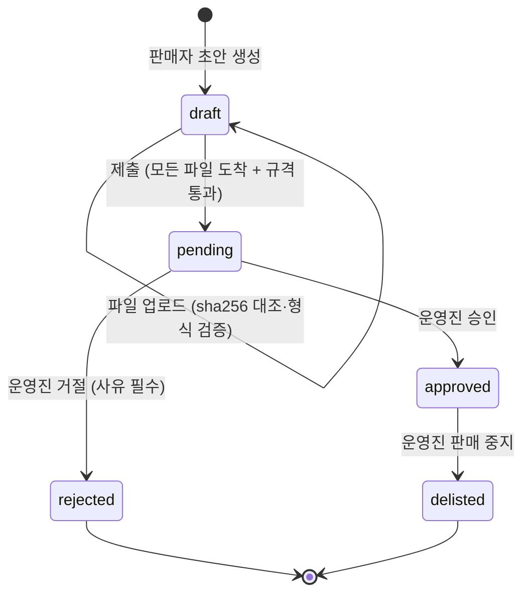
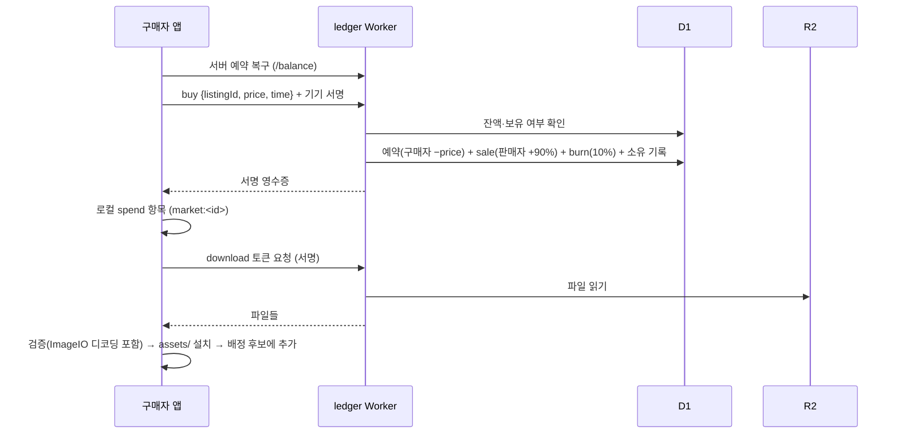
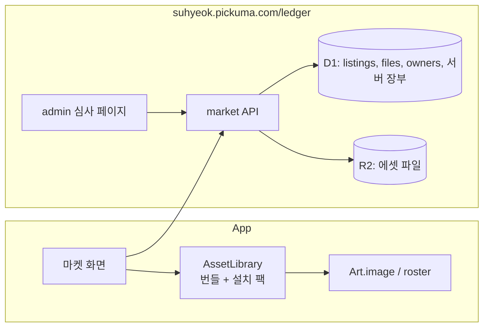

# feat: 캐릭터 마켓 — 사용자 제작 캐릭터를 결정으로 사고팔기 (운영진 승인제)

---

## Goal Capsule

- **1차 범위 = 캐릭터만 (2026-10-11 결정).** 맵은 2차로 미룸. 규격·서버는 `kind` 필드로 맵을 나중에 추가할 수 있게 둠
- **목표:** 사용자가 만든 캐릭터(초상화·스프라이트·모션)를 올리고, 운영진 승인을 거친 것만 다른 사용자가 결정으로 구매·적용함
- **선행 조건:** `feat/crystal-ledger`(결정 장부·발행 서버) main 병합 + 서버 배포. 이 계획은 그 위에 짓는 확장
- **권한 순서:** 사용자 지시 > Product Contract > Planning Contract > 구현 중 판단
- **정지 조건**
  - 결정의 현금화 경로가 생기는 설계가 필요해지면 멈추고 보고함
  - 업로드 에셋에 실행 가능한 내용(스크립트·코드·SVG 등)을 허용해야 하는 상황이면 멈춤
  - 운영 배포(R2 버킷, D1 마이그레이션, Worker 배포, 라우트)는 사용자 승인 후에만 실행함
  - 미커밋 작업이 있는 앱 파일(`WorldView.swift` 등)을 고쳐야 하면, 사용자 작업과 섞이지 않게 내 변경만 골라 커밋함
- **실행 프로필**
  - 앱: SwiftPM(`Sources/AgentDeck`), XCTest(`Tests/AgentDeckTests`)
  - 서버: `server/ledger` Worker + D1 + R2(신규 바인딩), `npm test`(node:test)

---

## Product Contract

### Summary

- **사용자 = 기기:** 결정 서버에 등록한 맥 한 대가 판매자·구매자 단위
- **에셋 종류:** 캐릭터(초상화 + 스프라이트 + 동작 프레임). 맵은 2차
- **흐름:** 올리기 → 심사 대기 → 운영진 승인(마켓 노출) 또는 거절(사유 표시) → 구매 → 내려받아 적용
- **대금:** 구매가의 90%는 판매자에게 결정으로, 10%는 소각. 모든 이전은 서버 장부에 기록되고 비트코인 공증 범위에 포함됨
- **현금화 없음:** 결정은 앱 안에서만 쓰임. 약관에 명시

### Problem Frame

- 지금 캐릭터 32명은 앱 번들에 고정됨. 사용자가 꾸밀 수단 없음
- 결정을 쓸 곳이 영입뿐이라 쌓이는 동기가 약함
- 사용자 제작물이 유통되면 저작권 침해·유해물·악성 파일 위험이 생김 → 운영진 승인과 형식 검증으로 막음

### 위협·위험

| 위험 | 대응 |
|---|---|
| 부풀린 결정으로 남의 에셋 구매 | 구매는 서버가 확인한 잔액으로만. 기존 장치(초대 코드, 시간당 상한) 유지 |
| 내 기기끼리 사고팔아 결정 세탁 | 자기 에셋 구매 차단. 초대 코드라 기기 다수 확보가 어려움. 수수료 소각으로 왕복할수록 손해 |
| 저작권 침해·유해 이미지 | 운영진 승인제, 신고·판매 중지 절차, 약관 |
| 악성 파일 (이미지 파서 공격, 압축 폭탄) | 압축 파일을 받지 않고 파일을 하나씩 받음. PNG/JPEG만, 크기·해상도 상한, 서버와 앱이 같은 규칙으로 검증 |
| 현금 거래(외부 RMT) | 현금화 경로 없음, 약관 금지. 운영진이 이상 거래를 판매 중지할 수 있음 |
| 기기를 바꾸면 산 에셋·수익을 잃음 | 이번 범위 밖. 2차의 '기기 이전'으로 해결 (Deferred) |

### Requirements

**에셋 규격**
- **R1.** 캐릭터 팩: `manifest.json` + 초상화(PNG/JPEG) + 스프라이트(PNG, 투명) + 동작 프레임(PNG, 투명). 필수 동작: `walk_down`·`walk_left`·`walk_up`(각 6장), `attack`(6장). 선택 동작: `hammer`·`read`·`type`(3장), `smith`·`study`·`write`(6장)
- **R2.** (2차로 미룸) 맵 팩. 1차 규격은 `kind: character`만 받고, 다른 `kind`는 거부함
- **R3.** 파일당·팩당 크기 상한과 해상도 상한을 둠. 허용 형식은 PNG·JPEG·JSON뿐임
- **R4.** 같은 검증 규칙을 서버(업로드 시)와 앱(설치 시)이 각각 적용함. 공유 테스트 벡터로 두 구현을 맞춤

**판매자**
- **R5.** 등록된 기기만 올릴 수 있음. 업로드 요청은 기기 보안칩 키로 서명함
- **R6.** 판매자가 이름, 설명, 가격(50~5,000 결정)을 정함. 제출하면 '심사 대기' 상태가 됨
- **R7.** 판매자는 자기 등록물의 상태(대기·승인·거절+사유·판매 중지)와 판매 내역을 봄
- **R8.** 판매 수익(90%)은 서버 잔액에 바로 반영됨. 로컬 장부에는 다음 정산 때 `income` 항목으로 들어옴

**운영진**
- **R9.** 심사 화면에서 대기 목록, 이미지 미리보기, 걷기·공격 애니메이션 재생을 제공함
- **R10.** 승인하면 마켓에 노출되고, 거절하면 사유가 필수임. 승인한 것도 나중에 판매 중지할 수 있음
- **R11.** 심사·판매 중지는 서버 장부에 기록함 (행 수정 없이 추가만)

**구매자**
- **R12.** 마켓에서는 승인된 에셋만 보임. 이름·판매자 기기 별칭·가격·미리보기를 보여 줌
- **R13.** 구매는 서버 정산을 켜고 등록한 기기만 할 수 있음. 서버가 먼저 차감하고, 로컬 장부에는 `spend`로 기록함(기존 영입 예약 방식 재사용)
- **R14.** 이미 산 에셋과 자기 에셋은 구매 불가
- **R15.** 산 에셋은 서명 URL로 내려받아 `~/Library/Application Support/Suhyeok/assets/`에 설치함. 설치 전에 R4 검증을 함
- **R16.** 산 캐릭터는 배정 후보 목록에 추가됨
- **R17.** 판매 중지된 에셋도 이미 산 사람의 설치본은 계속 동작함. 새 구매만 막음

**경제**
- **R18.** 구매가의 10%는 소각해 서버 장부에 기록함. 판매자 90%, 소각 10%, 구매자 −100%의 합이 0이 되도록 한 행 묶음으로 기록함

### Acceptance Examples

- **AE1.** A가 캐릭터를 300 결정에 올림 → 운영진 승인 → B가 구매 → B 서버 잔액 −300, A +270, 소각 30. B 앱에 캐릭터가 설치되고 새 세션에 배정될 수 있음
- **AE2.** 운영진이 '기존 게임 캐릭터 복제'를 사유로 거절 → A 화면에 '거절: 기존 게임 캐릭터 복제' 표시, 마켓에 미노출
- **AE3.** 스프라이트 대신 SVG를 넣어 올림 → 서버가 업로드 단계에서 거부, 심사 대기에 들어가지 않음
- **AE4.** B가 같은 에셋을 다시 구매 → '이미 보유'로 거부, 차감 없음
- **AE5.** 구매 확정 직후 B 앱이 종료됨 → 다음 실행 때 서버 예약이 로컬 `spend`로 복구되고, 파일도 다시 내려받음
- **AE6.** 판매 중지된 에셋 → 마켓에서 사라짐. 이미 산 B의 설치본은 그대로 동작함
- **AE7.** A의 판매 수익 270 → A가 다음 정산하면 로컬 장부에 `income +270`이 들어가고 로컬 잔액이 서버 잔액과 같아짐
- **AE8.** `kind: map` 팩 업로드 → 1차에서는 '지원하지 않는 종류'로 거부

### Scope Boundaries

- 제외: 결정의 현금화, 사용자 간 결정 직접 송금, 경매·할인
- 제외: 맵, 보스·UI 테마 등 캐릭터 외 에셋
- 제외: 에셋 안의 코드·스크립트·셰이더 (이미지와 JSON만)
- 제외: 판매자 실명·결제 정보 수집

### Deferred to Follow-Up Work

- **맵 팩 (2차):** 배경(JPEG 3840×2160) + 미니맵(2048×1152) + `walkmap.json`(격자·통로·`camp`/사냥터 자리·보스·화로). 검증(자리가 이동 가능 칸 위, 사냥터까지 경로 존재), 앱의 맵 선택, `WorldView.swift` 고정 좌표 이전, 심사 화면의 자리 좌표 겹쳐 보기 포함

- 기기 이전(이전 기기가 새 기기를 승인 → 잔액·보유 에셋·판매자 이력 이전)
- 신고 버튼과 신고 큐 (이번에는 운영진 판매 중지로 대응)
- 에셋 버전 업데이트(판매자가 수정본을 올리면 재심사 후 구매자에게 업데이트)
- 별점·리뷰, 검색·태그
- 판매자 별칭 검수 (이번에는 기기 ID 앞자리 + 판매자가 정한 별칭, 운영진이 바꿀 수 있음)

---

## Planning Contract

### Key Technical Decisions

- **KTD1. 압축 파일 대신 파일 단위 업로드**
  - 판매자는 먼저 초안(draft)을 만들고 `manifest.json`과 파일을 하나씩 올림. 파일마다 sha256을 manifest에 적고 서버가 대조함
  - 이유: 서버가 zip을 풀 필요가 없어 압축 폭탄·경로 조작(`../`) 위험이 사라짐. 파일마다 크기·형식을 바로 검사할 수 있음
- **KTD2. 검증은 헤더 수준에서 엄격하게**
  - PNG: 시그니처, IHDR의 폭·높이·색 형식, 텍스트 청크 크기 상한. JPEG: SOI/SOF로 폭·높이 확인. 둘 다 바이트 상한
  - 서버(JS)는 디코딩하지 않고 헤더만 검사함. 앱은 설치할 때 ImageIO로 실제 디코딩까지 확인함
  - 규칙 표와 통과·실패 샘플을 `server/ledger/test/asset-vectors/`에 두고 Swift·JS 테스트가 함께 씀
- **KTD3. 업로드·구매 요청은 기기 키 서명 (기존 spend 서명과 같은 방식)**
  - 정규화 JSON(`{"action":"publish",...}`, `{"action":"buy",...}`)에 P-256 서명. 시각 허용 오차와 재전송 방지(직전 요청보다 새 시각)도 기존 규칙을 재사용함
- **KTD4. 구매 = 기존 spend 예약 재사용 + 판매자 지급 행**
  - `/market/buy`가 구매자 차감 예약(item = `market:<listingId>`), 판매자 `sale +90%`, `burn 10%`를 한 트랜잭션으로 기록함
  - 구매자 로컬 `spend` 항목은 기존 예약 소비 로직으로 처리됨. 고아 예약 복구(AE5)도 기존 `bookOpenReservations`가 처리함
- **KTD5. 판매 수익은 `income` 항목으로 로컬에 반영 (clamp 자가 복구와 같은 방식)**
  - 서버는 기기별 `pendingIncome`(아직 로컬 장부에 없는 수익)을 영수증과 `/balance`에 담음
  - 앱은 `pendingIncome − 아직 안 보낸 income 항목 합`만큼 `income` 항목을 추가함. 서버는 그 항목을 `pendingIncome`에서 빼고 상한 계산에서 제외함
  - 장부 항목 종류에 `income` 추가 (Ledger·서버 KINDS·공유 벡터 갱신)
- **KTD6. 파일 저장은 R2, 내려받기는 Worker 발급 서명 토큰**
  - 키: `assets/<listingId>/<sha256>`. 같은 내용은 한 번만 저장함
  - 구매자는 `/market/download/<listingId>`에 서명된 요청을 보내 짧게 유효한 토큰을 받고, Worker가 R2에서 읽어 전달함
  - 미리보기(초상화·스프라이트 1장)는 승인 후 공개 경로로 제공함. 심사 대기 중에는 운영진만 볼 수 있음
- **KTD7. 심사 화면은 Worker가 서빙하는 정적 HTML 한 장**
  - `/ledger/admin/` 페이지 + 기존 관리자 Bearer 토큰. 토큰은 페이지에 입력하고 `sessionStorage`에만 둠
  - 애니메이션 미리보기는 프레임 이미지를 순서대로 바꿔 보여 줌
- **KTD8. 앱 에셋 로딩을 '에셋 소스' 계층으로 분리**
  - 지금 `Art`는 번들 경로에서만 읽음. 번들 + 설치 팩을 합친 `AssetLibrary`를 두고, `Art.image`·`Art.roster`가 이를 통해 읽게 함
  - 캐릭터 ID는 충돌을 막으려고 설치 팩이면 `market.<listingId>` 형태로 씀
- **KTD9. 상태 머신과 감사 기록**
  - 상태: `draft → pending → approved | rejected`, `approved → delisted`. 거절된 것은 판매자가 고쳐서 새 초안으로 다시 올림(덮어쓰기 없음)
  - 상태가 바뀔 때마다 서버 장부에 금액 0의 `moderate` 행을 추가해 해시 체인과 공증 범위에 포함함

### High-Level Technical Design

### Assumptions

- 가격 범위 50~5,000, 수수료 10% 소각 (CONFIG 상수로 조정)
- 크기 상한 초안: 캐릭터 팩 4MB, 파일당 1MB. 프레임 최대 256×256, 초상화 최대 1024×1365
- R2는 Cloudflare 무료 한도(10GB) 안에서 시작함
- 운영진 = Owen 한 명. 관리자 토큰 하나로 충분함

### Sequencing

- U1(규격·검증기)이 가장 먼저. 서버와 앱이 모두 여기에 의존함
- U2(앱 에셋 계층)는 U1 이후 서버 작업(U3·U4·U5)과 병렬로 진행할 수 있음
- U3(업로드·심사 API) → U4(구매·내려받기) → U6(앱 마켓 화면)
- U5(심사 페이지)는 U3 이후
- U7(income 정산)은 U4와 함께 진행함

---

## Implementation Units

### U1. 에셋 팩 규격과 공용 검증기

**Goal:** 캐릭터 팩의 형식과 검증 규칙을 정하고, 서버(JS)와 앱(Swift)에 같은 규칙의 검증기를 만듦
**Requirements:** R1, R2, R3, R4
**Dependencies:** 없음
**Files:**
- `docs/asset-pack-spec.md` (신규: 사람이 읽는 규격, 판매자용 제작 가이드 포함)
- `server/ledger/assets.js` (신규: manifest 스키마, PNG/JPEG 헤더 검사, walkmap 검사)
- `server/ledger/test/assets.test.js`, `server/ledger/test/asset-vectors/` (신규: 통과·실패 샘플과 기대 결과)
- `Sources/AgentDeck/AssetPack.swift` (신규: 같은 규칙 + ImageIO 디코딩 확인)
- `Tests/AgentDeckTests/AssetPackTests.swift` (신규: 같은 벡터 사용)
- `art/pack.py` (신규: 기존 기본 캐릭터를 팩으로 묶는 도구. 테스트 픽스처와 판매 예시용)

**Approach:**
- manifest: `kind`(1차는 `character`만), `format`(1), `name`, `files`(경로 → sha256·바이트), `frames`(동작 → 장수)
- 경로는 정해진 이름만 허용함(`portrait.png`, `sprite.png`, `frames/walk_down_0.png` 등). 임의 경로·하위 폴더 금지
- 기존 기본 캐릭터 1명을 `art/pack.py`로 묶어 '통과' 벡터로 씀

**Execution note:** 벡터와 테스트 먼저 작성함. 규격은 한 번 공개되면 바꾸기 어려움

**Test scenarios:**
- 기본 캐릭터 팩 → 통과 (Swift·JS 같은 결과)
- SVG 파일, 확장자만 PNG인 JPEG, 허용 안 된 경로(`../x.png`, `frames/sub/a.png`) → 실패 (Covers AE3.)
- 필수 동작 장수 부족(`walk_down` 5장) → 실패
- 해상도 초과 프레임, 파일당 크기 초과, sha256 불일치 → 실패
- `kind: map` 또는 모르는 `kind` → 실패 (Covers AE8.)
- 앱: 헤더는 정상이지만 디코딩이 안 되는 PNG → 실패 (앱만 해당)

**Verification:** 두 테스트 모음이 같은 벡터에 같은 결과를 냄. 기본 캐릭터 팩이 통과함

### U2. 앱 에셋 계층 (번들 + 설치 팩)

**Goal:** 앱이 내려받은 캐릭터를 기본 캐릭터와 똑같이 쓰게 만듦
**Requirements:** R15, R16, R17
**Dependencies:** U1
**Files:**
- `Sources/AgentDeck/AssetLibrary.swift` (신규: 설치 팩 목록, 이미지 로딩)
- `Sources/AgentDeck/Characters.swift` (`Art`가 AssetLibrary를 통해 읽음, roster 확장)
- `Sources/AgentDeck/Recruit.swift` (산 캐릭터는 영입 없이 배정 후보)
- `Tests/AgentDeckTests/AssetLibraryTests.swift` (신규)

**Approach:**
- 설치 위치: `assets/<listingId>/` + `installed.json`(목록·종류·설치 시각)
- `Art.image(name)`: 번들 → 설치 팩 순서로 찾음. 설치 캐릭터 ID는 `market.<listingId>`
- 배정 후보 = 기본 8명 + 영입한 캐릭터 + 산 캐릭터
- 설치 폴더가 지워졌거나 검증에 실패한 캐릭터는 배정 후보에서 빼고, 이미 그 캐릭터가 배정된 세션은 기본 캐릭터로 바꿈
- `Characters.swift`에는 미커밋 작업이 있음 → 내 변경만 골라 커밋함(이전 브랜치와 같은 방식)

**Test scenarios:**
- 기본 팩 형식으로 설치한 캐릭터 → `Art.image("frames/market.x/walk_down_1")`가 설치 파일을 반환
- 설치 캐릭터가 배정 후보에 포함되고, 영입 가격 계산에는 영향을 주지 않음
- 설치 폴더 삭제 → 배정 후보에서 빠지고 앱이 죽지 않음
- 판매 중지 정보와 무관하게 설치본은 계속 로드됨 (Covers AE6.)

**Verification:** `--snapshot-world`로 설치 캐릭터가 걷고 공격하는 월드를 캡처함

### U3. 서버: 초안·업로드·제출·심사 API

**Goal:** 판매자 업로드와 운영진 승인·거절·판매 중지를 서버에 구현함
**Requirements:** R3, R4, R5, R6, R7, R10, R11
**Dependencies:** U1
**Files:**
- `server/ledger/market.js` (신규: 상태 머신, 서명 검증, 한도)
- `server/ledger/worker.js` (라우트, R2 바인딩, D1 store 메서드)
- `server/ledger/schema.sql` (listings, listing_files 테이블. 상태 변경은 서버 장부 `moderate` 행)
- `server/ledger/wrangler.toml` (R2 버킷 바인딩 `ASSETS`)
- `server/ledger/test/market.test.js` (신규, R2는 메모리 가짜)

**Approach:**
- `POST /market/drafts`(manifest + 서명) → 초안 ID. `PUT /market/drafts/:id/files/:name`(본문 = 파일) → sha256·형식 검사 후 R2 저장. `POST /market/drafts/:id/submit` → 모든 파일 도착 + 규격 통과 시 `pending`
- 판매자 조회: `GET /market/mine?device=…`(서명 요청) → 상태·거절 사유·판매 수
- 관리자: `GET /admin/market/pending`, `POST /admin/market/:id/approve`, `POST /admin/market/:id/reject {reason}`, `POST /admin/market/:id/delist {reason}`
- 기기당 대기 중 초안 수 상한(예: 5)으로 스팸 방지

**Test scenarios:**
- 정상 캐릭터 팩 업로드·제출 → `pending`, 서버 장부에 `moderate` 행
- 미등록 기기, 서명 불일치, 해지 기기 → 거부
- manifest와 sha256이 다른 파일, SVG 파일 → 업로드 거부 (Covers AE3.)
- 파일 누락 상태로 제출 → 거부
- 거절 사유 없이 거절 → 400. 사유와 함께 거절 → 판매자 조회에 사유 표시 (Covers AE2.)
- 승인 → 공개 목록에 노출. 판매 중지 → 공개 목록에서 사라짐
- 가격 범위 밖(49, 5,001) → 거부
- 대기 초안 6개째 → 거부

**Verification:** `npm test` 통과. 서버 장부 검증(`/admin/verify`)이 심사 행을 포함해 정상

### U4. 서버: 구매·소유·내려받기

**Goal:** 결정으로 구매하고 판매자 지급·소각을 기록하며, 산 사람만 파일을 받게 함
**Requirements:** R12, R13, R14, R17, R18
**Dependencies:** U3
**Files:**
- `server/ledger/market.js`, `server/ledger/ledger.js` (예약 재사용, sale·burn 행)
- `server/ledger/worker.js`, `server/ledger/schema.sql` (owners 테이블)
- `server/ledger/test/market.test.js`

**Approach:**
- `GET /market/listings`(공개, 승인된 것만, 미리보기 URL 포함)
- `POST /market/buy {device, listingId, price, time, sig}` → 승인 상태·가격 일치·자기 것 아님·미보유·잔액 확인 → 한 트랜잭션으로 예약(구매자) + sale(판매자 +⌊price×0.9⌋) + burn(나머지) + owners 기록 → 서명 영수증
- `POST /market/download/:listingId`(서명) → 보유 확인 → 파일 목록 + 짧게 유효한 토큰. `GET /market/files/:token/:name` → R2 전달
- 판매 중지돼도 보유자는 내려받기 가능 (R17)

**Test scenarios:**
- 잔액 500인 B가 300짜리 구매 → B −300(예약), A +270, 소각 30, 서버 장부 합계 0 (Covers AE1.)
- 같은 에셋 재구매 → `already_owned`, 차감 없음 (Covers AE4.)
- 자기 에셋 구매 → 거부
- 요청 가격 ≠ 등록 가격(가격 변경 경쟁) → 거부
- 잔액 부족 → 거부, 아무 행도 안 생김
- 대기·거절·판매 중지 에셋 구매 → 거부
- 비보유자 내려받기 → 403. 판매 중지 후 보유자 내려받기 → 성공 (Covers AE6.)
- 만료된 토큰 → 403
- 구매 직후 구매자 로컬 `spend`가 정산되면 예약이 소비되고 이중 차감 없음 (Covers AE5.)

**Verification:** `npm test` 통과. 소각 합계가 `/admin/verify`에 별도 집계로 나옴

### U5. 운영진 심사 페이지

**Goal:** 운영진이 브라우저에서 대기 에셋을 보고 승인·거절·판매 중지함
**Requirements:** R9, R10
**Dependencies:** U3
**Files:**
- `server/ledger/admin.html` (신규: 정적 페이지, Worker가 `/ledger/admin/`에서 서빙)
- `server/ledger/worker.js` (페이지 라우트, 심사용 비공개 미리보기 라우트)
- `server/ledger/test/worker.test.js` (페이지·미리보기 접근 제어)

**Approach:**
- 토큰 입력 → `sessionStorage` 보관 → 대기 목록 카드: 초상화, 스프라이트, 걷기·공격 프레임 재생, 판매자 기기 별칭·이전 이력(승인·거절 수), 가격
- 거절·판매 중지 버튼은 사유 입력 없이는 비활성화
- 페이지는 외부 스크립트 없이 인라인만 씀, CSP 헤더 적용

**Test scenarios:**
- 토큰 없이 비공개 미리보기 요청 → 401
- 페이지 응답에 CSP 헤더 포함
- 승인·거절 호출이 U3 API와 같은 결과를 냄 (API 테스트 재사용)

**Verification:** `wrangler dev`에서 테스트 팩 하나를 승인·거절까지 진행하며 스크린샷 확인

### U6. 앱 마켓 화면 (둘러보기·구매·설치·올리기)

**Goal:** 길드 화면 옆에 마켓 탭을 두어 구매·설치·적용과 판매 등록을 함
**Requirements:** R5, R6, R7, R12, R13, R14, R15, R16
**Dependencies:** U2, U4
**Files:**
- `Sources/AgentDeck/MarketClient.swift` (신규: 목록·초안·업로드·제출·구매·내려받기 API, 서명 요청)
- `Sources/AgentDeck/MarketView.swift` (신규: 둘러보기, 내 에셋, 올리기, 판매 내역)
- `Sources/AgentDeck/Workspace.swift` (사이드바 '마켓' 항목)
- `Sources/AgentDeck/CrystalBank.swift` (구매 = 예약 복구 → buy → spend → 내려받기 → 설치)
- `Tests/AgentDeckTests/MarketClientTests.swift` (신규, 가짜 서버)

**Approach:**
- 올리기: 폴더 선택 → 앱이 U1 검증으로 먼저 확인(오류 목록 표시) → 초안 생성 → 파일 업로드 → 제출
- 구매 순서는 영입과 같음: 서버 정산 켬 + 등록 필수, 고아 예약 복구 후 진행, 중복 클릭 방지
- 설치 실패(검증 실패·내려받기 실패) 시 '다시 받기' 버튼. 결정은 이미 서버에 반영된 상태
- 산 캐릭터는 길드 화면 보유 목록에 추가

**Test scenarios:**
- 구매 성공 → 로컬 `spend(market:<id>)` + 설치 폴더 생성 + 배정 후보 증가 (Covers AE1.)
- 서버가 `already_owned` 응답 → 로컬 장부 변화 없음, 다시 받기 안내 (Covers AE4.)
- 구매 확정 후 앱 종료를 흉내 냄(로컬 spend 없이 재시작) → 예약 복구 + 내려받기 재시도 (Covers AE5.)
- 내려받은 파일 하나의 sha256이 다름 → 설치 거부, 기존 설치본 유지
- 올리기 전 로컬 검증 실패 → 서버 요청 없음
- 서버 정산이 꺼져 있거나 미등록 → 구매·올리기 버튼 비활성화와 안내 문구

**Verification:** `--snapshot-market`으로 화면 캡처. 가짜 서버 대상 전체 흐름 테스트 통과

### U7. 판매 수익의 로컬 반영 (`income`)

**Goal:** 판매자의 로컬 장부가 서버 잔액과 맞도록 수익을 기록함
**Requirements:** R8
**Dependencies:** U4
**Files:**
- `Sources/AgentDeck/Ledger.swift` (`income` 종류 추가)
- `Sources/AgentDeck/LedgerSync.swift` (`pendingIncome` 반영, clamp와 같은 자가 복구)
- `server/ledger/ledger.js` (KINDS에 `income`, pendingIncome 처리, 상한 제외)
- `server/ledger/test/vectors.json` (income 항목 벡터 추가)
- `Tests/AgentDeckTests/LedgerSyncTests.swift`, `server/ledger/test/ledger.test.js`

**Approach:**
- 서버: sale 행이 판매자 `pendingIncome`을 늘림. 판매자가 `income` 항목을 보내면 그만큼 줄이고 잔액에는 더하지 않음(이미 더함). `pendingIncome`보다 큰 income은 거부함
- 앱: 영수증·`/balance`의 `pendingIncome − 아직 안 보낸 income 합`만큼 `income` 항목을 추가함

**Test scenarios:**
- 판매 270 → 판매자 다음 정산에서 로컬 `income +270`, 로컬 잔액 = 서버 잔액 (Covers AE7.)
- income 항목 유실 후 재시작 → 다음 영수증에서 다시 기록됨
- 받을 수익보다 큰 income을 보낸 조작 기기 → 정산 거부
- income은 시간당 상한에 포함되지 않음

**Verification:** 판매자·구매자 두 기기를 흉내 낸 서버 테스트에서 양쪽 로컬·서버 잔액이 모두 일치함

---

## Verification Contract

- `swift test` 전체 통과, `server/ledger`의 `npm test` 전체 통과
- U1 공유 벡터: Swift·JS 결과 일치
- `./build.sh` 성공, 오프스크린 스냅샷(`--snapshot-world`, `--snapshot-market`)으로 화면 확인. 사용자 화면에 합성 클릭을 하지 않음
- `wrangler dev`로 업로드 → 승인 → 구매 → 내려받기 → 설치 전체 흐름을 한 번 실행함
- 운영 배포(R2 버킷 생성, D1 스키마 적용, Worker 배포)는 사용자 승인 후 진행함

---

## Definition of Done

- R1–R18 구현, 각 AE에 대응하는 테스트 통과
- 기본 캐릭터를 팩으로 묶은 예시가 업로드·승인·구매·설치·배정까지 됨
- 서버 장부에 구매(−), 판매(+90%), 소각(10%), 심사 행이 기록되고 검증·공증 범위에 포함됨
- 비밀키·관리자 토큰이 저장소·앱·심사 페이지 코드에 없음
- 약관 문구(현금화 금지, 저작권 책임, 판매 중지 권한)가 마켓 화면과 올리기 화면에 노출됨
- 실험하다 버린 코드가 diff에 남아 있지 않음

---

## Risks & Dependencies

- **선행 브랜치:** `feat/crystal-ledger` 병합과 결정 서버 배포가 먼저 필요함
- **미커밋 작업과 충돌:** U2·U6이 `Workspace.swift`·`Characters.swift`를 건드림. 사용자의 미커밋 작업이 그대로면 내 변경만 골라 커밋하고, 그 상태만 따로 빌드해 확인함
- **2차 맵 대비:** 1차 규격·서버는 `kind` 필드와 종류별 검증기 구조로 만들어 맵을 추가할 때 테이블·API를 바꾸지 않게 함
- **Workers 한도:** 업로드·내려받기는 R2 전달이라 CPU 부담이 적음. 정산과 같은 유료 플랜 전제
- **법·약관:** 현금화 경로가 없어도 사용자 간 이전이 생겼음. 약관과 운영 정책(판매 중지·신고 처리) 문서가 필요함. 정밀한 법률 판단은 전문가 확인 권장
- **운영 부담:** 승인제라 심사 대기가 쌓일 수 있음 → 기기당 대기 상한, 심사 페이지에서 판매자 이력 표시
- **기기 = 사용자 한계:** 맥 교체·키 교체 시 보유 에셋과 판매자 이력이 분리됨 → 기기 이전(Deferred)
- **제작 난이도:** 동작 프레임(걷기 3방향·공격 각 6장)을 직접 그리기 어려움 → 규격 문서에 기존 생성 파이프라인(`art/gen.py`·`art/process.py`) 사용법을 판매자 가이드로 포함

## Sources & Research

- 현재 에셋 구조: `art/out/frames/<id>/`(walk_down·walk_left·walk_up·attack 각 6장, 작업 동작 3~6장), `art/out/sprites/<id>.png`, `art/out/portraits/<id>.jpg`, `art/out/field_4k.jpg`(3840×2160), `art/out/field.jpg`(2048×1152), `art/out/walkmap.json`(res·cols·rows·corridors·spots·bosses·fire·cells; spots = camp 32, attack_low 21, attack_mid 21, attack_high 20)
- 로딩 코드: `Sources/AgentDeck/Characters.swift`(`Art.image`, `Art.roster`), `Sources/AgentDeck/WorldView.swift`(`World.image`, 프레임 이름 규칙), `Sources/AgentDeck/Pathfinder.swift`(walkmap.json)
- 결정 시스템: `docs/plans/2026-10-11-001-feat-crystal-ledger-anchoring-plan.md`, `server/ledger/ledger.js`(spend 예약, clamp 처리)
