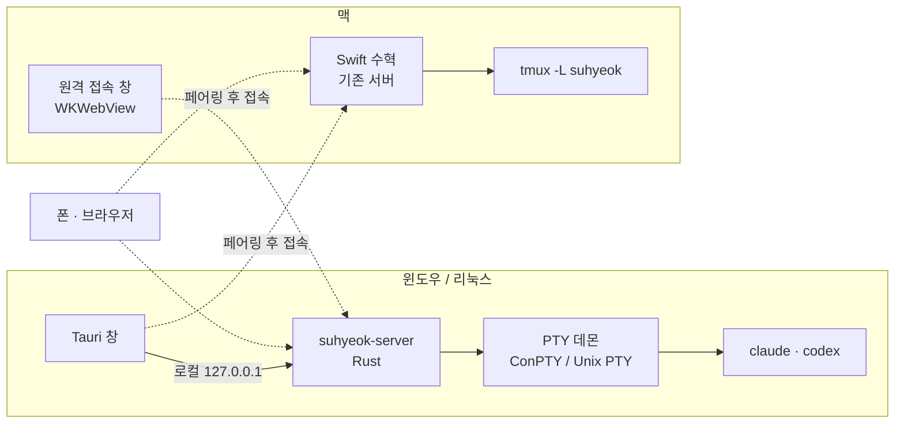

# 수혁 서버 Rust 이식: 윈도우·리눅스 단독 실행과 OS 간 상호 접속

- 작성: 2026-11-17
- 상태: 초안 (사용자 승인 전, 코드 변경 없음)

## 결론

- 윈도우·리눅스용 수혁 서버를 Rust로 새로 만들고, 기존 Tauri 앱(`windows/`)에 넣음
- 맥은 Swift 앱을 유지하고, 다른 OS의 수혁 서버에 붙는 창만 추가함
- 모든 서버가 같은 HTTP 계약(`/desk`, `/pair`, `/api/*`)을 지킴 → 어느 OS의 화면으로든 어느 OS의 서버에 접속 가능
- 첫 출시 범위는 맥과 같은 기능 전체(사용자 결정). 단, 음성은 OS별 대체 부품이 필요해 마지막 단계에 둠

## 사용자가 확정한 결정 (2026-11-17)

| 항목 | 결정 |
|---|---|
| 맥 앱 | Swift 앱 유지 + 원격 서버 접속 창 추가 |
| 서버 간 접속 | 같은 망·Tailscale 직접 접속이 기본, Cloudflare 터널은 선택 |
| 첫 버전 범위 | 맥과 같은 기능 전체(결정·마켓·음성 포함) |
| 윈도우 세션 실행 | 윈도우 기본 터미널(ConPTY). 리눅스·윈도우 모두 같은 PTY 방식 |

## 용어

- **서버**: 세션을 읽고 실행하며 HTTP 계약을 제공하는 수혁 프로세스. 맥 = Swift 앱 안, 윈도우·리눅스 = `suhyeok-server`(Rust)
- **화면**: 서버가 내주는 `/desk` 웹 페이지. Tauri 창, 맥 접속 창, 브라우저 어디서나 같음
- **계약**: 서버가 지켜야 하는 경로·요청·응답 형식 묶음

## 구조

## 맥 전용 부품과 대체안

| 기능 | 맥(현재) | 윈도우·리눅스(Rust) |
|---|---|---|
| HTTP 서버 | Network `NWListener` | axum + tokio |
| 세션 읽기 | ClaudeSource·CodexSource·AntigravitySource (SQLite) | 같은 파일 형식을 Rust로 파싱 (serde_json, rusqlite) |
| 세션 실행·유지 | tmux 전용 서버 | portable-pty(ConPTY/Unix PTY) + 백그라운드 서버 프로세스 |
| 화면 상태 | tmux capture-pane | vt100 파서로 화면 버퍼 유지 |
| 권한 메뉴 해석 | SessionInput.swift | Rust로 이식, 기존 `Fixtures/screens`를 같은 테스트로 공유 |
| 내장 터미널 | SwiftTerm | 화면 쪽 xterm.js |
| 장부 서명 키 | 키체인 + CryptoKit | keyring 크레이트(윈도우 자격 증명 관리자, 리눅스 Secret Service) + ed25519/p256 크레이트 |
| 결정 적립·사냥 규칙 | CrystalBank·Hunt | Rust 이식, 같은 테스트 값 사용 |
| 마켓 | MarketService | 같은 장부 Worker API 호출 |
| 알림 | UserNotifications | Tauri notification 플러그인 |
| 상단바 | NSStatusItem | Tauri 트레이 |
| 업데이트 | brew upgrade | Tauri updater(서명 키 필요) |
| 음성 인식·호출어 | Apple Speech | whisper.cpp 한국어 모델(기기 안) |
| 답변 요약 | FoundationModels(기기 안) | 대체 필요: 소형 로컬 모델 또는 Claude API (비용 발생, 결정 필요) |
| 읽어 주기 | Supertonic + 시스템 음성 | Supertonic ONNX + OS 기본 음성 |
| 외부 터미널 화면 읽기 | tmux·Orca·cmux | 리눅스 tmux만 가능, 나머지는 대화 기록으로 자동 전환(현재 규칙과 같음) |

## 단계 (각 단계는 검증을 통과해야 다음으로 감)

| 단계 | 내용 | 검증 |
|---|---|---|
| 0. 계약 고정 | 맥 서버의 경로 24개와 응답 형식을 문서·JSON 스키마로 정리. `/desk` 페이지를 Swift 문자열에서 정적 파일로 분리해 두 서버가 같은 파일을 씀 | 맥 서버가 스키마 테스트 통과, 맥 앱 동작 변화 없음 |
| 1. 읽기 서버 | Rust 서버: 세션 읽기, `/api/state` `/api/chat` `/api/sidebar` `/api/events`, 페어링·쿠키·Host 검사, `/desk`·아트 제공 | 같은 스키마 테스트 + 기존 `/desk` 화면 캡처 스크립트를 Rust 서버에 실행, 맥과 화면 비교 |
| 2. 세션 실행 | PTY 데몬, 새 세션·이어서·종료, 지시 보내기, 키 입력, 터미널, 권한 메뉴 해석, 재시작 후 `--resume` 복원 | `Fixtures/screens` 공유 테스트 통과, 리눅스 컨테이너에서 실제 Claude Code 세션 생성·지시 |
| 3. Tauri 앱 | 서버를 백그라운드로 띄우는 창 앱, 서버 목록(로컬 + 원격) 전환, 트레이, 알림, 로그인 시 자동 실행. 맥 Swift 앱에 원격 서버 창 추가 | 리눅스 실기, 윈도우는 CI 빌드 + 사용자 실기 |
| 4. 원격 접속 | 기본은 127.0.0.1, 설정에서 LAN·Tailscale 주소로 열기(사용자 동의 후), Cloudflare 터널(빠른 터널·고정 도메인) 선택 | 맥 ↔ 리눅스 ↔ 윈도우 3방향 페어링·작업 |
| 5. 결정·마켓 | 장부 키 생성·보관, 적립 규칙, 동기화, 마켓 구매·등록 | 기존 장부 테스트 값과 같은 결과, 장부 Worker 개발 환경에서 종단 테스트 |
| 6. 음성 | 호출어·받아쓰기(whisper.cpp), 읽어 주기(Supertonic), 요약(결정 필요) | 한국어 예문 인식률 측정, 맥과 같은 문장 처리 |
| 7. 배포 | GitHub Actions로 윈도우(NSIS)·리눅스(AppImage, deb) 빌드, 업데이트 채널, 릴리스 스크립트 연결 | 릴리스 산출물 설치 시험 |

## 저장소 배치

- `server-rs/`: Rust 워크스페이스 (`suhyeok-core` 세션·규칙, `suhyeok-server` HTTP·PTY)
- `desktop/`: 윈도우·리눅스 공용 Tauri 앱(옛 `windows/`)
- `web/desk/`: 두 서버가 함께 쓰는 `/desk` 정적 파일
- `contract/`: 계약 스키마와 계약 테스트

## 위험과 한계

- 서버 로직이 Swift·Rust 두 벌이 됨 → 계약 테스트와 공유 픽스처로 어긋남을 잡음. 기능 추가 때마다 두 곳을 고쳐야 함
- PTY 방식은 서버 프로세스가 세션을 쥠 → 서버 업데이트·재시작 때 세션이 끊김. tmux처럼 살아남지 못함. 대신 `--resume`으로 같은 대화를 다시 엶(맥의 재부팅 복원과 같은 방식)
- 윈도우 실기 검증 수단이 이 맥에 없음 → CI 빌드·단위 테스트까지만 자동, 실제 동작은 사용자 확인 필요
- 음성 요약은 기기 안 대체 모델이 없음 → 로컬 소형 모델(품질·용량 문제) 또는 Claude API(사용량 비용) 중 선택 필요
- LAN 노출: 기본값은 로컬 전용. 외부 주소로 여는 것은 설정에서 명시적으로 켬
- 결정 장부: 기기 등록·서명 규칙이 서버 쪽과 맞아야 함 → 장부 Worker는 바꾸지 않고 클라이언트만 이식

## 미결 사항

- 음성 요약 수단 (로컬 모델 / Claude API)
- Tauri updater 서명 키 보관 위치
- 리눅스 배포 형식 범위 (AppImage만 / deb·rpm 포함)

## 진행 기록

### 0단계 계약 고정 — 완료 (2026-11-17)

- `web/desk.html`로 페이지 분리, `DesktopPage.swift`는 읽기만 함, `build.sh`가 번들에 복사
- `contract/README.md` 계약 문서, `contract/check.mjs` 계약 검사(읽기·보안 29항목)
- 검증: 맥 서버 `/desk` 출력이 분리 전과 같음(끝 줄바꿈 1바이트 차이), 맥 서버 계약 검사 29/29, `swift test` 166개 통과

### 1단계 읽기 서버 — 완료 (2026-11-17)

- `server-rs/` 크레이트: `model`, `sessions/*`, `transcript`, `usage`, `world`, `hunt`, `characters`(라이브러리) + `src/app/*`(HTTP·페어링·사이드바·이벤트·저장소)
- 검증
  - Rust 서버 계약 검사 29/29
  - `contract/compare.mjs`로 맥 서버와 같은 시각 비교: 세션 15/15 같은 ID, 위치·사냥터·상태·제목·대화 기록·사용량 일치
  - 헤드리스 크롬에서 `/desk` 화면(월드·목록·대화·사용량·최근 대화) 정상
- 남은 차이
  - 캐릭터 배정 13/15 불일치(원인 조사 중)
  - 사냥 문구 천 단위 쉼표
  - `crystals`(5단계)
  - 수혁 세션 분류(2단계, tmux·PTY)
  - 폰 페이지(`/`)는 아직 `/desk`로 대신함(번역 문자열 21개 분리 필요)

### 2단계 세션 실행 — 완료 (2026-11-17)

- `src/menu.rs`: 권한 메뉴 해석, 지시 보내기·키·선택 규칙(SessionInput·TerminalMenu·LiveReply·HostedMenu 이식, 화면 픽스처 13개 공유)
- `src/pty/`: PTY 호스트(portable-pty + vt100), 에이전트·셸 실행, 화면 버퍼·`/api/term`, 열린 대화 기록과 재시작 후 `--resume` 복원
- API 연결: send(5초 중복 방지), key, choose, choose-hosted, term·term-input·term-new, new, resume, action(clone·rename·clear·end·migrate), upload
- 서버 터미널을 tmux 창처럼 경계로 처리: 그 안의 에이전트는 최상위 수혁 세션(같은 터미널 안의 부모만 유지)
- 새 터미널에서 상속받은 Claude Code 세션 표시 변수 제거(CLAUDE_CODE_CHILD_SESSION 등). 남아 있으면 새 Claude가 대화 기록·세션 등록을 남기지 않음
- 검증
  - 실제 Claude Code 종단 시험: 셸 입력 → 새 세션(폴더 신뢰 메뉴 응답) → 답 읽기 → 지시·중복 방지 → 종료 모두 통과
  - 테스트: 맥 라이브러리 127 + 서버 5, 리눅스 컨테이너 8회 연속 127 통과
- 남은 것: 윈도우 ConPTY 실기 검증(코드는 cfg로 분리, 이 맥에서 컴파일 불가), 키 입력 응용 커서 모드 실측

### 3·4단계 서버 쪽 — 완료 (2026-11-17)

- 주인 토큰(`<데이터 폴더>/owner-token`, 0600)과 주인 경로: `/owner`, `/pair/owner`, `/api/owner/{info,pending,decide,pair-start,devices,forget,network,shutdown}` — 같은 컴퓨터(127.0.0.1)에서만
- LAN·Tailscale: 주인이 켜면 포트+1(기본 4381)에 두 번째 리스너. Host는 IP 숫자 주소나 등록한 이름만, 주인 경로 거부, 쿠키는 http라 Secure 없음
- Cloudflare 터널: `cloudflared` 빠른 터널·고정 터널(`named-tunnel.yml`), 주소를 허용 호스트에 추가 — 실제 터널은 대외 노출이라 미실행(미검증)
- 검증: 주인 흐름·LAN 페어링·호스트 규칙·끄기 시험 통과, 맥·리눅스 테스트 통과

### 3단계 데스크톱 앱 — 맥에서 빌드·실행 확인 (2026-11-17)

- `desktop/`(옛 `windows/`): 서버 내장 실행(분리 프로세스, 앱을 꺼도 유지), 주인 창 자동 로그인, 서버 목록 전환, 연결 요청 허용 창(기본 버튼 = 거부), 다른 기기 연결 링크, 연결된 기기, 트레이(열기·서버 종료·앱 종료), 로그인 시 자동 실행
- `desktop/prepare.sh`: 서버 바이너리(타깃 접미사)와 아트 폴더 조립, `.github/workflows/desktop.yml`: 윈도우·우분투 서버 테스트 + NSIS·AppImage·deb 빌드
- 맥 `RemoteServers.swift`: "다른 컴퓨터의 수혁…"(⇧⌘O) 창, 링크 붙여넣기·서버 목록·웹뷰, Info.plist에 로컬 네트워크 허용
- 서버 반영: 쿠키 Secure는 https에서만(WebKit이 127.0.0.1 http의 Secure 쿠키를 버림), 주인 기기 교체, 맥에서 데이터 폴더 `Suhyeok-server`
- 미검증: 윈도우·리눅스 실행(CI는 커밋·푸시 후에만 돎), 클릭이 필요한 UI 흐름
